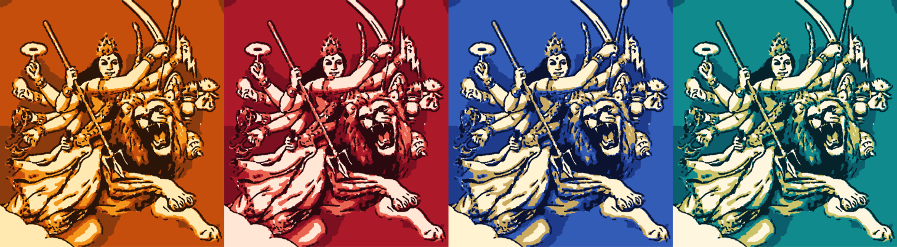

# 🔱 Maa Durga – Live Sketch Studio

Watch Maa Durga artwork draw itself **live** – first as a pencil sketch, then filled with colour, then inked.
Built with **Python, Turtle, OpenCV and Tkinter**. Three artworks are built into the single `durga.py` file, so **no image download is needed**.

<p align="center">
  
</p>

## ✨ Features

- 🖌️ **Live stroke-by-stroke drawing** – pencil outlines → colour fills → dark ink
- 🎨 **3 built-in artworks** – Durga face, Durga on lion (pencil drawing), Durga & Mahishasura (silhouette)
- 🌈 **5 colour themes** – Original, Saffron & Gold, Navratri Red, Royal Blue & Gold, Peacock Teal
- 🖼️ **Open any image** – sketch your own picture with the *Open image* button
- ⏯️ **Playback controls** – pause, restart, skip to the end, speed slider, progress bar
- 💾 **Save PNG** – export the finished art in high resolution
- 📦 **One file** – everything (including the artwork) lives in `durga.py`

## 🖼️ Gallery

**Durga on Lion – pencil drawing**

<p align="center">
  
</p>

**Durga & Mahishasura – silhouette**

<p align="center">
  
</p>

**Colour themes on the same drawing**

<p align="center">
  
</p>

## 🚀 Quick start

```bash
git clone https://github.com/surya323-ma/Maa-Durga-Live-Sketch-Studio.git
cd Maa-Durga-Live-Sketch-Studio
pip install -r requirements.txt
python durga.py
```

Requires **Python 3.8+** with Tkinter (included with the standard Windows/macOS installers;
on Linux run `sudo apt install python3-tk`).

## 🎮 Controls

| Action | Button | Key |
|---|---|---|
| Play / Pause | Pause | `Space` |
| Restart | Restart | `R` |
| Skip to finished art | Skip | `End` |
| Save PNG | Save PNG | `S` |
| Open your own image | Open image | `O` |
| Change colour theme | Colour dropdown | `C` |
| Pick artwork 1 / 2 / 3 | Artwork dropdown | `1` `2` `3` |
| Speed up / down | Speed slider | `↑` `↓` |
| Quit | – | `Esc` |

## ⚙️ Command-line options

```bash
python durga.py                                   # built-in artwork
python durga.py my_picture.png                    # sketch your own image
python durga.py my_picture.png --mode sketch --colors 7 --width 700
python durga.py --theme "Navratri Red"            # start with a colour theme
python durga.py --export-images                   # save durga.jpg, face.png, lion.png
```

| Option | Description |
|---|---|
| `--mode` | `sketch` (pencil → colour → ink), `pencil` (shading + ink lines), `color` (direct colour layers), or `auto` |
| `--colors` | Number of colour layers, 3–9 (more = more detail) |
| `--width` | Canvas width in pixels (default 720) |
| `--theme` | `Original`, `Saffron & Gold`, `Navratri Red`, `Royal Blue & Gold`, `Peacock Teal` |
| `--export-images` | Write the built-in artworks as normal image files and exit |

## 🧠 How it works

1. **Colour quantisation** – k-means groups the image into a few colours; a soft vote smooths the edges.
2. **Contour extraction** – each colour region becomes polygons (outer outline + holes) using OpenCV.
3. **Pencil pass** – every outline is traced as a thin, slightly wobbly grey line.
4. **Colour pass** – regions are filled from light to dark, so the darkest ink goes on last.
5. **Turtle animation** – a generator draws a few points per frame, which makes pause, speed and skip smooth.

## 🛠️ Troubleshooting

- **`can't open file ... durga.py`** – your terminal is in the wrong folder. `cd` into the folder that contains `durga.py` first (use quotes if the path has spaces).
- **`Could not open 'durga.jpg'`** – you are running an older version of the script. Use the latest `durga.py` from this repo, which needs no image.
- **Downloaded file is named `durga (1).py`** – run `python "durga (1).py"` or rename it to `durga.py`.
- **`No module named cv2`** – run `pip install opencv-python numpy`.
- **`No module named tkinter`** – install Tkinter (`sudo apt install python3-tk` on Linux).
- **Drawing is slow** – move the Speed slider right, or press `End` to skip to the finished art.

## 📁 Project structure

```
Maa-Durga-Live-Sketch-Studio/
├── durga.py                # the whole app (code + built-in artwork)
├── requirements.txt        # opencv-python, numpy
├── README.md
├── LICENSE
├── demo-face.gif           # images shown in this README
├── demo-lion.gif
├── demo-silhouette.gif
└── colour-themes.png
```

> The four images must sit in the **same folder as README.md** (the repo root) for them to show on GitHub.

## 🙏 Credits

Built for Navratri with Python. Jai Mata Di! 🚩

## 📄 License

MIT – see the [LICENSE](LICENSE) file.
